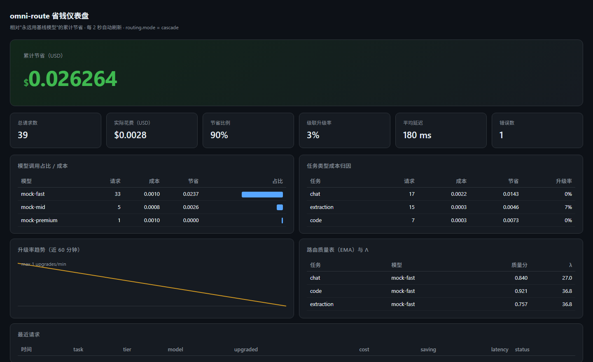

# omni-route

<p align="center">
  <strong>OpenAI 兼容的多模型智能路由网关：按任务/成本/延迟自动选模型，级联省钱，每次请求都告诉你“为什么选它”。</strong>
</p>

<p align="center">
  <a href="https://github.com/attnstack/omni-route/stargazers"></a>
  <a href="LICENSE"></a>
  <a href="https://github.com/attnstack/omni-route/actions"></a>
  <a href="https://github.com/attnstack/omni-route/releases"></a>
  
</p>

<p align="center">
  <a href="#-quick-start">Quick Start</a> ·
  <a href="#-工作原理">工作原理</a> ·
  <a href="#-benchmark">Benchmark</a> ·
  <a href="#-已知不足">已知不足</a> ·
  <a href="#-contributing">Contributing</a>
</p>

> 多模型矩阵已成标配：代码用 DeepSeek、长文用 Gemini、便宜任务用小模型——但每个应用的接入、限流、重试、成本观测都要重写一遍。omni-route 把这些收敛到一个 **OpenAI 兼容的 `/v1` 端点**：客户端只改一个 `base_url`，网关负责“选谁、试错、升级、记账”。

**核心能力**：任务分类 → 成本-质量打分（拉格朗日 λ 自适应 + Thompson Sampling 在线探索）→ 级联执行（便宜模型先行，置信度判别不过关再升级）→ 限流/重试/熔断/failover → 每次请求返回可解释路由头 + 省钱仪表盘。

## 📸 Demo



> 截图来自内置 mock provider 的 demo 配置（零 API key）：累计节省为主视觉，级联升级率、模型成本分布、任务归因、路由质量表（EMA 与 λ 实时值）一屏可见。命令行演示见下方 Quick Start。

## ⚡ 30 秒 Quick Start

零 API key，内置 mock provider 端到端演示：

```bash
# 1. 启动网关（需要 Go ≥ 1.22）
go run ./cmd/omni-route -config config.demo.yaml

# 2. 另开终端，发起请求（注意响应头）
curl -sD - -o /dev/null http://localhost:8080/v1/chat/completions \
  -H 'Content-Type: application/json' \
  -H 'x-or-task: extraction' \
  -d '{"messages":[{"role":"user","content":"提取订单信息并返回 JSON：订单号 A-100，金额 99 元"}]}'
# 观察响应头：x-or-route-reason / x-or-model / x-or-cost-usd / x-or-savings-usd

# 3. 流式（OpenAI 协议标准 SSE）
curl -N http://localhost:8080/v1/chat/completions \
  -H 'Content-Type: application/json' \
  -d '{"model":"mock-mid","messages":[{"role":"user","content":"讲个故事"}],"stream":true}'

# 4. 打开省钱仪表盘
# 浏览器访问 http://localhost:8080/
```

接真实模型：复制 [config.example.yaml](config.example.yaml)，填 `key_env` 对应的环境变量（OpenAI / DeepSeek / Anthropic），启动命令相同。**客户端只需要把 base_url 指到 `http://localhost:8080/v1`。**

本地已有 Ollama？零 API 费用直接用真实模型：

```bash
# 确保 Ollama 已运行且拉取了 qwen2.5:3b / qwen2.5:7b（真·级联链：3b 先行 → 判别 → 7b）
go run ./cmd/omni-route -config config.ollama.yaml   # 监听 :8081

# Windows Git Bash 注意：含中文的请求体用文件传，避免本地代码页编码把 prompt 变乱码
curl -sD - http://localhost:8081/v1/chat/completions -H 'Content-Type: application/json' \
  -d @scripts/demo_request.json
```

成本策略对比基准：

```bash
go run ./cmd/omni-bench -config config.demo.yaml -dataset data/bench_tasks.jsonl
```

## ✨ 特性

| 特性 | 说明 |
|---|---|
| OpenAI 协议兼容 | `/v1/chat/completions`（流式 SSE + 非流式）、`/v1/models`；openai-python / langchain 直接可用 |
| 多协议适配 | OpenAI 系（DeepSeek/Qwen/Ollama 通用一个适配器）+ Anthropic Messages API 双向翻译（含工具调用） |
| 任务分类 | 双语规则分类器（6 类任务，0 依赖，微秒级）；`x-or-task` 头显式覆盖兜底 |
| 成本-质量路由 | `score = Q − λ·C`；λ 随预算消耗自适应；Thompson Sampling（Beta 后验精确采样）做在线探索利用 |
| 级联执行 | 便宜模型先行 → 格式校验/启发式判别/LLM judge/自一致性四档置信度判别 → 按需升级；升级率在线校准（目标 ≈30%） |
| 可解释路由 | 每个响应头带 `x-or-route-reason`；响应体可选附级联报告 `omni_route`；SQLite 全量请求日志 |
| 可靠性 | 每 provider 令牌桶限流（对齐 RPM 配额）、指数退避重试、滑动窗口熔断、跨模型 failover、客户端断连即停 |
| 省钱仪表盘 | 内嵌单页（构建期 embed，无静态文件依赖）：累计节省主视觉、模型占比、升级率趋势、任务成本归因 |
| 可复现基准 | omni-bench 四策略对比（premium/cheap/cascade/lagrangian），确定性 seed，CI 可跑 |

## 🏗 工作原理

```mermaid
flowchart LR
    C[客户端<br>改 base_url 即接入] --> GW

    subgraph GW[omni-route 网关]
        AUTH[鉴权/限长/日志] --> DEC[路由决策]
        DEC -->|"分类：6 类任务"| CLS[规则分类器]
        DEC -->|"硬约束：能力/合规/上下文"| F[过滤]
        DEC -->|"score = Q − λ·C<br>Q ~ Beta(a,b) 采样"| S[打分 + Thompson 探索]
        S -->|非流式| CAS[级联执行器<br>小模型 → 判别 → 升级]
        S -->|流式| DIRECT[单模型直选]
        CAS --> EX[执行层<br>限流/重试/熔断/failover]
        DIRECT --> EX
        EX --> P1[OpenAI 系适配器]
        EX --> P2[Anthropic 适配器]
        EX --> P3[Mock 适配器]
        GW -.->|异步| DB[(SQLite 请求日志)]
        GW -.->|状态快照| ST[(state.json)]
    end
    P1 --> UP1[OpenAI/DeepSeek/Ollama]
    P2 --> UP2[Claude]
    P3 --> UP3[内置 mock]
```

### 核心算法

**1. 拉格朗日成本-质量打分**（`internal/router`）

```
目标：max E[quality]  s.t.  E[cost] ≤ budget（按任务类型）

score(model) = Q(model) − λ·C(model)
λ ← clip(λ · (1 + η·(spent/budget − 1)), λ_min, λ_max)
```

Q 是 (task, model) 维度的质量 EMA（α=0.2），C 是按 token 单价与长度估算的单请求成本。预算消耗超前 → λ 上调 → 偏好便宜模型；预算宽松 → λ 下调 → 偏好质量。λ 的量纲是“质量分/美元”，默认 init=50（Q∈[0,1]、单请求成本 1e-4~1e-2 USD，两者同量级可比）。

**2. Thompson Sampling 探索**（`internal/router/bandit.go`）

每个 (task, model) 维护 Beta(α, β) 后验（reward∈[0,1] 连续伪观测，指数族标准更新）。决策时采样 `q̃ ~ Beta(a,b)` 代入打分，而不是用点估计——冷启动自动多探索，数据多了自动贴优。Beta 采样用两个 Gamma 之比（Marsaglia-Tsang 拒绝采样），30 行零依赖。**拉格朗日是骨架（保证不超预算），Bandit 在骨架内贴优**，两层解耦、各自可关。

**3. 级联经济学**（`internal/cascade`）

不是“选一个最好的模型”，而是**先用小的试，不可靠才升级**。置信度判别按边际成本从低到高：

| 档位 | 成本 | 能拦住什么 |
|---|---|---|
| 格式校验 | 0（确定性） | 非法 JSON、截断、空回答 |
| 启发式 judge | 0（本地计算） | 过短回答、拒答、答非所问 |
| LLM judge（可选） | 一次小模型调用 | 语义层面的“答得不好” |
| 自一致性（可选） | k 次采样 | 推理类任务的不稳定输出 |

判别不过关 → 升级链上下一级。阈值在线校准：升级率高于目标（默认 30%）说明阈值太严（小模型白跑）→ 放宽；过低说明该升没升 → 收紧。

**明确的协议级取舍**：级联只用于非流式。流式一旦吐出 chunk 就无法“撤回”，升级会向客户端重复发送内容——所以流式一律单模型直选。这是文档里写死的决策，不是没做。

## 📦 Benchmark

```bash
go run ./cmd/omni-bench -config config.demo.yaml -dataset data/bench_tasks.jsonl
# 四要素：测试集 = data/bench_tasks.jsonl（48 条合成任务，6 类 × 8 条）；
#        样本量 = 每策略 48 次请求 × 4 策略；对比基线 = premium（永远用最强模型）；
#        统计显著性 = 确定性模拟（seed 固定，重跑结果一致），无抽样误差。
```

| 策略 | 说明 | 成本（48 请求合计） | 准确率 | 升级次数 |
|---|---|---|---|---|
| premium | 永远用基线模型 | $0.054995 | 100% (48/48) | — |
| cheap | 永远用最便宜模型 | $0.002083 | 91.7% (44/48) | — |
| **cascade** | 小模型先行+判别升级 | **$0.004923** | **100% (48/48)** | 4 |
| lagrangian | Q−λC 打分直选 | $0.003861 | 91.7% (44/48) | — |

> 上表为 **mock 模拟实测**（本机 Windows/amd64，`config.demo.yaml`，seed=42，确定性可复现——任何机器重跑数字完全一致）。
> 解读：cheap 比 premium 省 96.2% 但答错 4 题；**cascade 的 4 次升级恰好补回全部 4 个错误**，以 91.0% 的成本节省达到与 premium 相同的准确率。
> **这不是真实模型质量的证据**（oracle 是 mock 的确定性生成器，见下方声明）；真实模型口径见下一张表。

**真实模型实测（Ollama 本地，2026-10-31）**：`qwen2.5:3b → qwen2.5:7b` 级联链，24 条任务（6 类 × 4），质量用 7b 做 LLM-as-judge 评分（judge 是代理指标，且与 premium 同源，数字仅作参考），成本为影子价格折算（近似 qwen-turbo/plus 云端单价量级，见 `config.ollama.yaml` 注释）。原始数据在 `reports/bench-ollama.md`。

```bash
go run ./cmd/omni-bench -config config.ollama.yaml -dataset data/bench_tasks_real.jsonl \
  -judge qwen2.5:7b -max-tokens 700 -temperature 0
```

| 策略 | judge 通过率 | judge 均分 | 总成本（影子价） | 相对 premium 节省 | 升级次数 | 平均耗时 |
|---|---|---|---|---|---|---|
| premium（永远 7b） | 100% (24/24) | 0.917 | $0.008359 | — | 0 | 4.82s |
| cheap（永远 3b） | 91.7% (22/24) | 0.892 | $0.001022 | 87.8% | 0 | 3.27s |
| cascade（3b→7b） | 95.8% (23/24) | 0.904 | $0.001692 | 79.8% | 4 | 3.83s |
| lagrangian | 91.7% (22/24) | 0.892 | $0.001022 | 87.8% | 0 | 3.03s |

cascade 卡在 cheap 和 premium 之间：质量比 cheap 高 4 个百分点，成本只比 cheap 多花 8 个百分点的节省。mock 基准里 cascade 能追平 premium，真实模型上做不到——判别器和 judge 的信号都不够准，这是当前的主要短板。

调这个基准的过程中踩了几个坑，记录一下：

- 最初把 `max_tokens` 设成 220，代码题的回答全被截断，格式校验判 truncated 后触发升级——表面上像"判别器误升级"，实际是基准参数的问题。`-detail` 参数就是排查这个时加的。
- 试用 3b 给自己当判别 judge，效果和纯启发式几乎一样，而且打分偏苛刻（分不出 0.5 和 0.8 的回答），后来换成 7b。
- 校准器一度只在更新数据、没接到判别决策上（阈值读的是静态配置），修掉之后补了 `TestCheckerWiredCalibratorAffectsDecisions` 防回归。
- 分任务校准在小流量下凑不满窗口（24 条 ÷ 6 类），校准器改成了全局阈值；冷启动首窗内会有个别漏检，流量上来后自愈。

路由决策开销（网关自身延迟；`go test -bench=. -benchmem ./internal/router/`，Windows/amd64 @ Ryzen 7 7735H）：

| 基准 | 结果 |
|---|---|
| BenchmarkDecide（分类+过滤+打分+TS 采样） | 6,134 ns/op, 1,216 B/op, 21 allocs/op |
| BenchmarkDecideExplicit（显式模型直通） | 707 ns/op |
| BenchmarkRecordOutcome（状态回写） | 98 ns/op |
| BenchmarkSampleBeta（Beta 后验采样） | 184 ns/op, 0 allocs |

> 结论：路由决策在 6µs 量级，相对上游模型调用（百毫秒级）占比 < 0.01%——"网关不增加可感知延迟"的实测依据。不同机器数字会漂移，以你自己环境重跑为准。

## 🚀 从零跑通（交付验证清单）

```bash
# 0. 前置：Go ≥ 1.22（国内环境建议 export GOPROXY=https://goproxy.cn,direct）
go version

# 1. 安装依赖（本仓库仅 2 个直接依赖：yaml.v3 + modernc.org/sqlite 纯 Go 无 CGO）
go mod tidy                                   # 预期：生成 go.sum，无报错

# 2. 构建
go build ./...                                # 预期：静默通过
go vet ./...                                  # 预期：无输出

# 3. 测试（单元 + 集成，全部基于 mock，不需要 key）
go test ./...                                 # 预期：全部 ok，含端到端网关测试

# 4. 性能基准
go test -bench=. -benchmem ./internal/router/  # 预期：BenchmarkDecide 微秒级/次

# 5. 成本策略基准
go run ./cmd/omni-bench -config config.demo.yaml -dataset data/bench_tasks.jsonl
# 预期：输出四策略对比表；cascade 成本显著低于 premium 且准确率接近

# 6. 启动 demo 网关
go run ./cmd/omni-route -config config.demo.yaml
# 预期日志：omni-route listening addr=:8080 providers=1 models=3 mode=cascade

# 7. 演示请求（另一终端）
curl -sD - -o /dev/null http://localhost:8080/v1/chat/completions \
  -H 'Content-Type: application/json' \
  -H 'x-or-task: extraction' \
  -d '{"messages":[{"role":"user","content":"提取并返回 JSON：订单号 A-100"}]}'
# 预期：200；x-or-route-reason: task=extraction,tier=cascade,model=mock-premium,upgraded=true,...

# 8. SSE 兼容矩阵（Git Bash）
bash scripts/sse_matrix.sh                    # 预期：ALL SSE MATRIX CHECKS PASSED

# 9. 仪表盘
# 浏览器打开 http://localhost:8080/ —— 累计省钱金额、升级率、最近请求
```

## ⚙️ 配置速查

<details>
<summary>完整配置项（含默认值）</summary>

| 键 | 默认 | 含义 |
|---|---|---|
| `listen` | `:8080` | 监听地址 |
| `api_keys` | `[]`（放行并告警） | 网关自身鉴权，客户端 `Authorization: Bearer <key>` |
| `seed` | `0`（随机） | 非 0 时路由决策可复现 |
| `providers.*.kind` | — | `openai` / `anthropic` / `mock` |
| `providers.*.rpm` | 600 | 令牌桶速率（对齐上游配额） |
| `models.*.price_in/out` | — | USD / 1M tokens，成本计算与省钱口径的基准 |
| `models.*.caps` | — | streaming/tools/json_mode/max_context_tokens，硬约束过滤依据 |
| `routing.mode` | `cascade` | `direct` / `lagrangian` / `cascade` |
| `routing.budget_per_task` | — | USD / 1k 请求，λ 自适应的约束目标 |
| `routing.baseline` | 最贵模型 | 省钱参照系（“永远用最强模型”的反事实） |
| `routing.compliance_groups` | — | 数据合规组：`x-or-data-class` 命中后只允许组内 provider |
| `routing.lambda.{init,min,max,eta}` | 50/1/5000/0.05 | λ 自适应参数 |
| `cascades.<task>` | — | 级联链（≤ max_upgrades+1 级） |
| `cascade.confidence.threshold` | 0.6 | 初始置信度阈值（在线校准会漂移） |
| `cascade.confidence.llm_judge` | 关 | judge 模型 + 采样率（异步，不阻塞请求） |
| `reliability.{retries,backoff_base_ms}` | 2/200 | 重试策略（仅幂等场景 + 首字节前） |
| `reliability.breaker.*` | 300s/20/0.2/30s | 滑动窗口熔断 |
| `timeouts.{connect,first_byte,total}_ms` | 5000/60000/300000 | 上游超时三件套 |

</details>

## 🔌 API 扩展

网关在 OpenAI 协议之外提供少量自有端点：

| 端点 | 说明 |
|---|---|
| 请求头 `x-or-task` | 显式指定任务类型（`code/reasoning/summarization/translation/extraction/chat`），跳过分类器 |
| 请求头 `x-or-data-class` | 数据合规分类，命中 `compliance_groups` 后收窄可用 provider |
| `POST /v1/feedback` | `{"request_id":"...","verdict":"good"\|"bad"}` —— 点踩直接降该 (task, model) 质量分 |
| `GET /api/stats`、`GET /api/requests` | dashboard 数据源 |
| `POST /admin/reload` | 热加载配置（需 `admin_key_env`） |
| 响应头 `x-or-*` | route-reason / model / cost / savings / request-id / failover-from |
| 响应体 `omni_route` | 非流式级联请求附完整级联报告（各级得分、成本、升级原因） |

## 已知不足

1. **级联不覆盖流式**——协议级取舍（见上）。改进方向：首 N token 缓冲判别 + SSE retry 语义，代价是首 token 延迟。
2. **规则分类器的天花板**——混合意图（“翻译这段代码”）按权重取最高，会有错分；错分靠 `x-or-task` 覆盖 + 反馈闭环兜底，没有自动纠偏。
3. **启发式 judge 是代理指标**——切题度=关键词覆盖率（已做跨语言中性化）、完整度=长度比例，会被"复读问题"的答案骗过；refusal 关键词对含"无法"的翻译内容会误报（实测中出现过 1 次）。LLM judge 可选开启，但 judge 自身的能力下限决定判别上限（3b 当判官的实测教训，见 Benchmark 章节）。
4. **校准阈值是全局单一的**——分任务阈值需要每任务足够的流量填满窗口，小流量任务上分桶校准形同虚设（实测教训）；全局 θ 首窗有冷启动漏检，长流量自愈。改进方向：分任务阈值 + 流量保障、或贝叶斯式先验融合。
5. **单进程状态**——质量/λ/熔断都在内存，快照落盘但多副本部署会各学各的。改进方向：状态外置（Redis）+ 定期对账。
6. **Token 估算误差 ±20%**——provider 不报 usage 时按 CJK/拉丁启发式估算，已打 `estimated` 标注；成本敏感场景建议用 `stream_options.include_usage`（网关已自动补）。
7. **mock 基准 ≠ 真实质量**——mock 成本对比是模拟结论；真实口径为本地 Ollama + 影子价格 + judge 评分（见 Benchmark 章节），真实云端 key 复测仍是 TODO。
8. **无语义缓存**——相同请求直接命中可再省一层（方案里的“重做会加”，尚未实现）。
9. **多模态不透传**——content 仅支持文本，图片/音频 content 数组会被降级。

## 🤝 Contributing

见 [CONTRIBUTING.md](CONTRIBUTING.md)。快速通道：

```bash
gofmt -l -w . && go vet ./... && go test -race ./...
```

提交前请确认：新功能带测试；碰核心算法（路由/级联）的 PR 需说明对 benchmark 结果的影响。

## 📄 License

[MIT](LICENSE)
